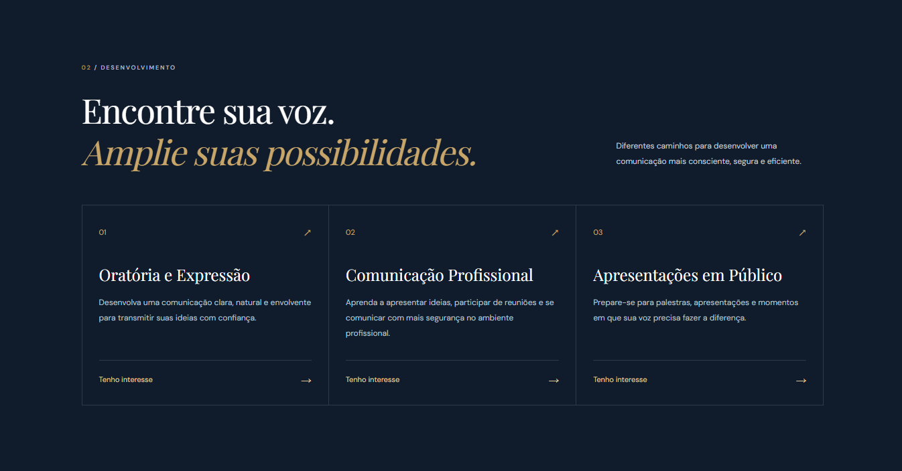
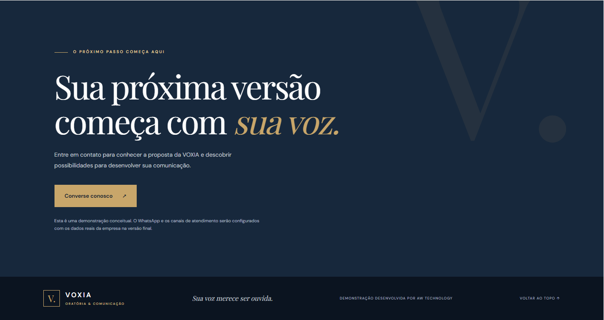

# VOXIA — Oratória & Comunicação

### Landing Page Demonstrativa | AW TECHNOLOGY

A **VOXIA** é uma landing page conceitual desenvolvida para uma escola fictícia de oratória e comunicação. O projeto demonstra como uma apresentação digital moderna pode valorizar uma marca, apresentar seus cursos e incentivar o contato com potenciais alunos.

Desenvolvida pela **AW TECHNOLOGY**, a página combina identidade visual sofisticada, navegação intuitiva e layout responsivo.

## 🌐 Demonstração

**Projeto:** Landing page conceitual para uma escola de oratória e comunicação.

**Status:** Demonstração publicada para apresentação de portfólio.

## 🖥️ Capturas de Tela

### Página Inicial

Apresentação da marca VOXIA, com destaque para a proposta de comunicação, identidade visual e chamada principal.


### Cursos

Seção dedicada à apresentação das áreas de desenvolvimento em oratória, comunicação profissional e apresentações em público.



### Contato e Rodapé

Área final da landing page, com chamada para contato e identificação do projeto demonstrativo.



## ✨ Funcionalidades

- Landing page responsiva para computadores, tablets e smartphones.
- Identidade visual conceitual para a marca VOXIA.
- Seção institucional sobre a proposta da escola.
- Apresentação de cursos por meio de cards.
- Seção de diferenciais e benefícios.
- Navegação por âncoras entre as seções.
- Chamada para contato.
- Interface personalizada com cores, tipografia e elementos visuais sofisticados.

## 🛠️ Tecnologias Utilizadas

- **Next.js**
- **React**
- **TypeScript**
- **Tailwind CSS 4**
- **CSS**
- **Git e GitHub**

## 📁 Estrutura do Projeto

```text
voxia-oratoria/
├── docs/
│   └── screenshots/
│       ├── voxia-home.png
│       ├── voxia-cursos.png
│       └── voxia-contato.png
├── public/
├── src/
│   └── app/
│       ├── globals.css
│       ├── layout.tsx
│       └── page.tsx
├── .gitignore
├── package.json
├── package-lock.json
├── next.config.ts
├── tsconfig.json
└── README.md
```

## 💻 Como Executar Localmente

### Pré-requisitos

- Node.js
- npm
- Git

### 1. Clone o repositório

```bash
git clone https://github.com/awaldige/voxia-oratoria.git
```

### 2. Acesse a pasta

```bash
cd voxia-oratoria
```

### 3. Instale as dependências

```bash
npm install
```

### 4. Inicie o ambiente de desenvolvimento

```bash
npm run dev
```

Acesse `http://localhost:3000` no navegador.

### 5. Verifique a compilação de produção

```bash
npm run build
```

## 📱 Responsividade

A interface foi desenvolvida para proporcionar uma experiência consistente em diferentes tamanhos de tela, incluindo computadores, tablets e smartphones.

## ⚠️ Sobre a Demonstração

A **VOXIA é uma marca fictícia**, criada exclusivamente para fins demonstrativos e de portfólio.

Os cursos, textos institucionais e demais conteúdos são conceituais. O projeto não representa uma instituição real de ensino.

O botão de contato apresenta uma mensagem demonstrativa. A integração com WhatsApp e os canais de atendimento deverão ser configurados com os dados oficiais de uma eventual empresa contratante.

## 👨‍💻 Desenvolvido por AW TECHNOLOGY

Projeto desenvolvido por **AW TECHNOLOGY**, com foco na criação de soluções web modernas, interfaces responsivas e experiências digitais profissionais.

**GitHub:** https://github.com/awaldige

---

*VOXIA — Sua voz merece ser ouvida.*